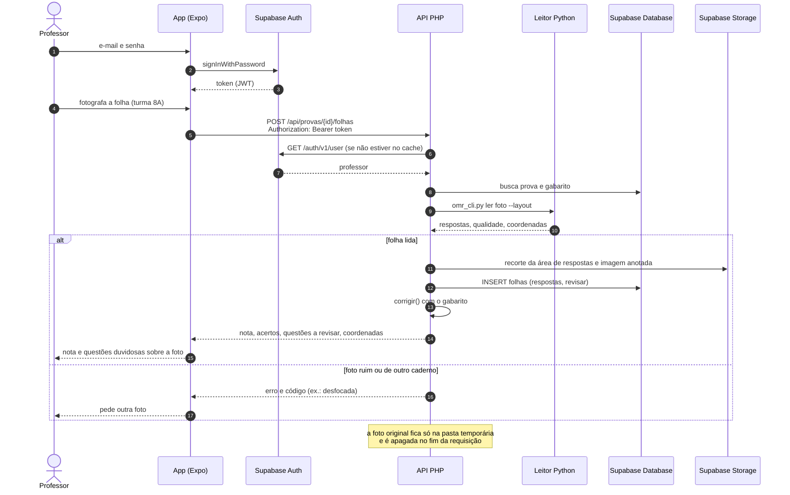
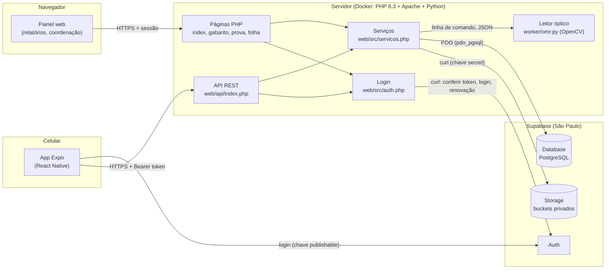

# Diagramas da Fase 6 (referência para o Visual Paradigm)

Rascunho em Mermaid dos dois diagramas que o plano pede nesta fase. Servem de
base para desenhar a versão final no Visual Paradigm (salvar o `.vpp` e as
imagens nesta pasta). O GitHub e o VS Code mostram os diagramas abaixo.

## Sequência: foto da folha até a nota no celular

## Componentes e implantação

Pontos para o texto do TCC:

- **Uma regra só:** a API e as páginas chamam as mesmas funções de
  `servicos.php`; a correção continua em um lugar.
- **O app não acessa o banco:** usa o Supabase só para o login. As tabelas têm
  RLS ligado e sem políticas; só o PHP, conectado direto no PostgreSQL, lê e grava.
- **O Python não conhece o banco:** recebe a foto e devolve JSON.
